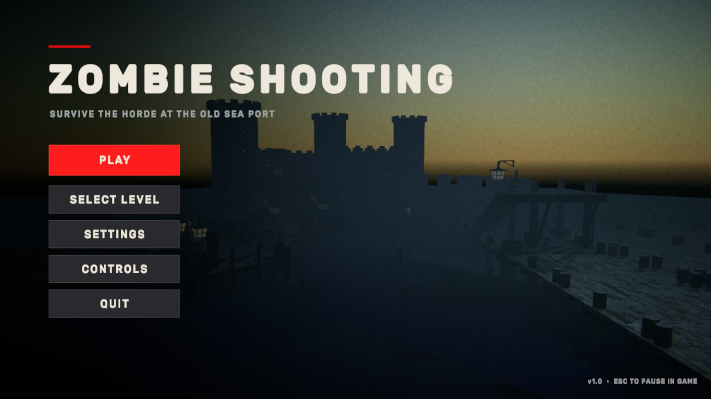
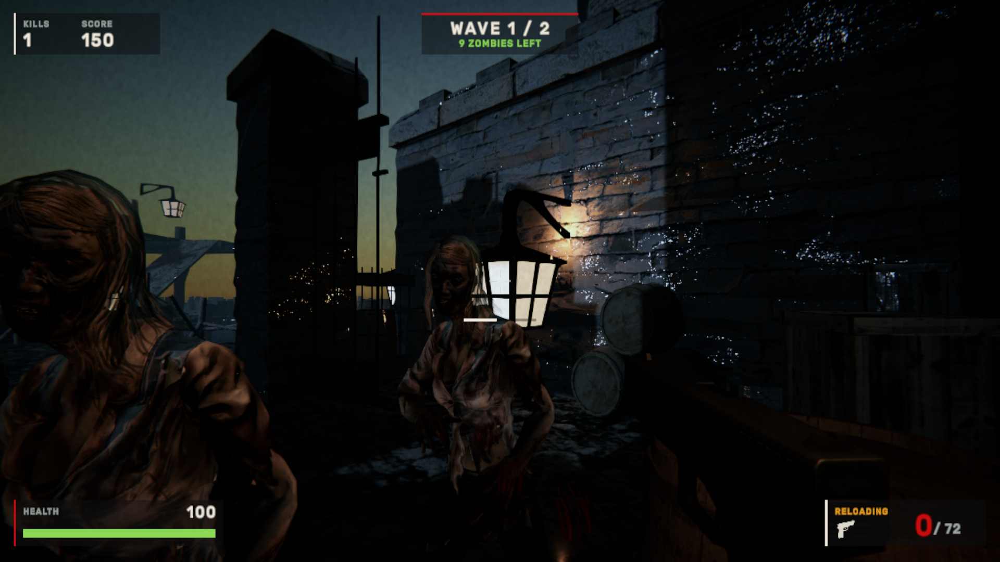
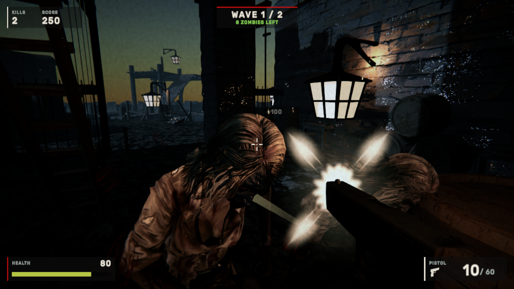
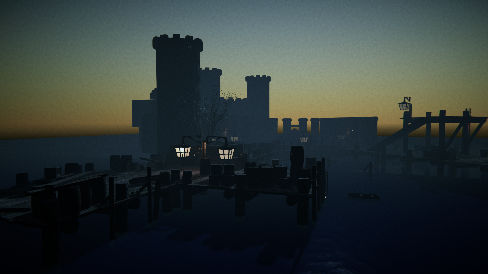
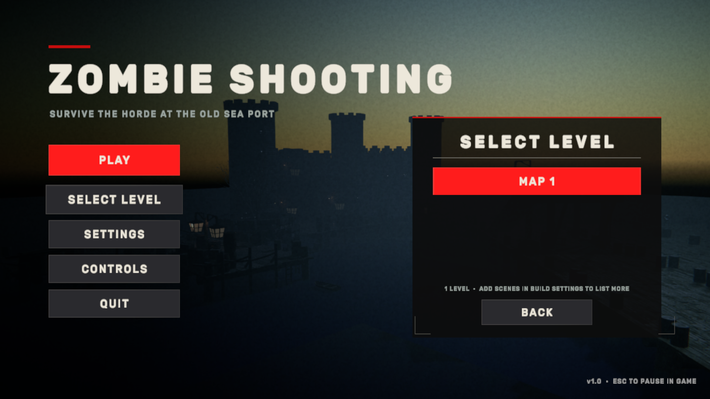
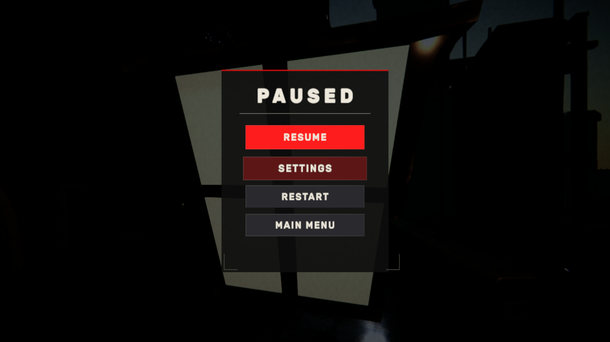
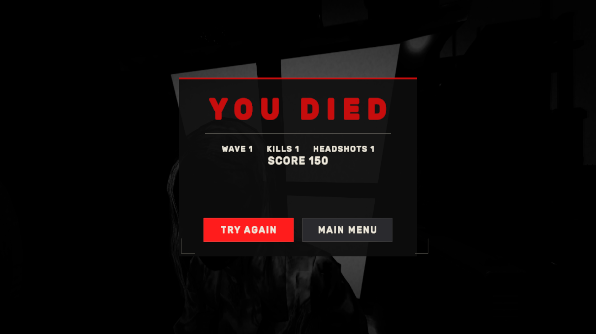
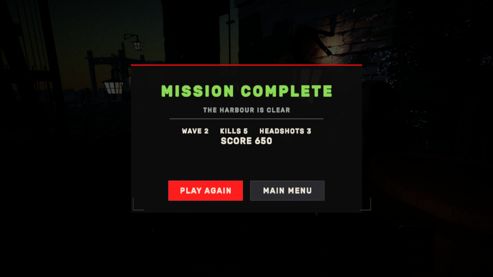

# Zombie Shooting

A first-person wave-survival shooter built in **Unity 6 (URP)**. Hold the fog-drowned Old Sea Port at dusk against waves of zombies with nothing but a pistol, then clear the harbour to complete the mission.

▶ **Gameplay video:** https://drive.google.com/file/d/1Ixo48PIYQGk3y6uZsTTM4hFBAbkZPvZM/view?usp=sharing



## Screenshots

| | |
|---|---|
|  |  |
|  |  |
|  |  |
|  | |

## Features

- **Wave survival** with an intermission between waves, ammo restocked after every cleared wave, and zombies that get faster and tougher each wave.
- **Zombie AI** on a NavMesh: detect, chase, attack, stagger when hit, and always chase back when shot.
- **Gunplay:** headshots (2.5× damage), recoil that kicks the view, weapon sway and bob, muzzle flash, bullet tracers, impact sparks and bullet-hole decals, auto-reload on an empty magazine.
- **Combat HUD:** dynamic crosshair, hit markers, kill and headshot score pop-ups, damage-direction indicators, health bar, ammo counter, and a wave / zombies-left tracker.
- **Atmosphere:** URP post-processing (ACES tonemapping, colour grading, bloom, vignette, film grain), exponential fog, glowing lanterns, and a red pulse at the screen edges when health is low.
- **Menus:** main menu with level select, settings (mouse sensitivity, volume, invert Y, fullscreen) and controls, plus pause, death and mission-complete screens. All are built at runtime with code-wired buttons.

## Controls

| Action | Key |
|---|---|
| Move | W A S D |
| Look | Mouse |
| Shoot | Left mouse |
| Reload | R |
| Sprint | Left Shift |
| Jump | Space |
| Pause | Esc |

## Getting started

1. Install **Unity 6000.6.3f1** (or a compatible Unity 6 version) with the Universal Render Pipeline.
2. Clone this repository and open the `Zombie shooting` folder in Unity Hub.
3. Open `Assets/Scenes/MainMenu.unity` and press **Play** (or open `Assets/Scenes/Map1.unity` to jump straight into the game).

> In the Editor, click once inside the **Game** view so it has focus. Unity ignores mouse input in Play mode while the Game view isn't focused.

## Project structure

```
Zombie shooting/Assets/
├─ Scenes/            MainMenu, Map1
├─ Scripts/
│  ├─ Core/           GameState, GameBootstrap (adds HUD, menus and atmosphere at runtime)
│  ├─ Player/         PlayerController, MouseLook
│  ├─ Weapon/         Shoot, WeaponAnim, WeaponFX
│  ├─ Zombies/        ZombieAI, ZombieWaveSpawner, ZombieDeathTracker
│  ├─ UI/             UIKit, MainMenuUI, GameMenusUI, UISkin, InputDeviceGuard
│  ├─ Visual/         GameHUD, AtmosphereDirector
│  └─ MainMenu/       PauseManager, DeathScreen, MissionCompleteUI, WaveUIManager, …
└─ Resources/UISkin.asset   fonts, button frames and sounds used by the UI
```

## Credits

Third-party assets used in this project:

- **Old Sea Port**: harbour environment
- **War FX** by Jean Moreno (JMO): muzzle flash effects
- **Modern Menu 1** by SlimUI: UI fonts, button frames and menu sounds
- **XtremeFPS** by Spoiled Unknown: pistol model and weapon sounds
- **Mixamo**: zombie characters and animations
- **Simple Water Shader** by IgniteCoders, **Blood Decals and Effects**, **Health System** by Code Monkey
- **TextMesh Pro**, Unity
